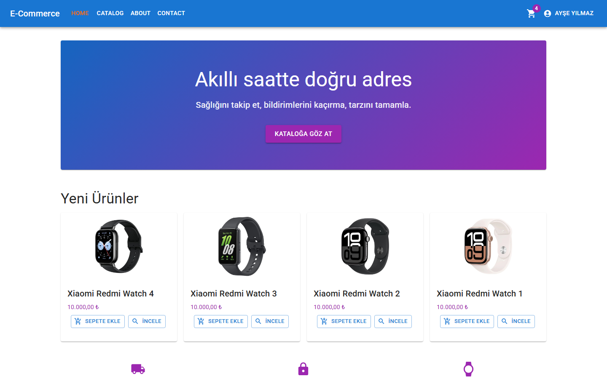
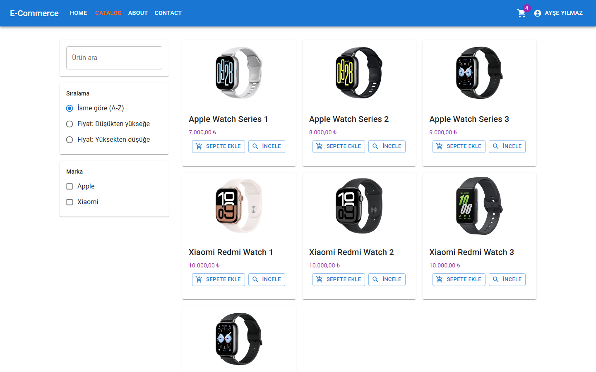
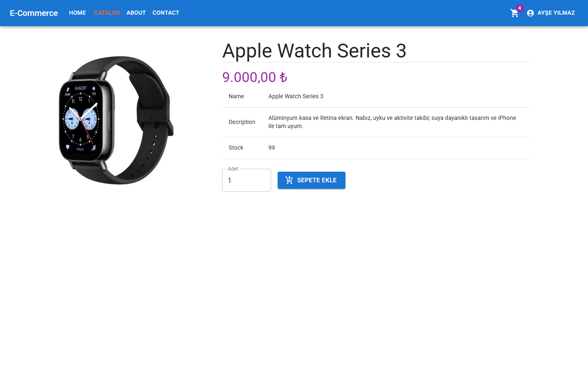
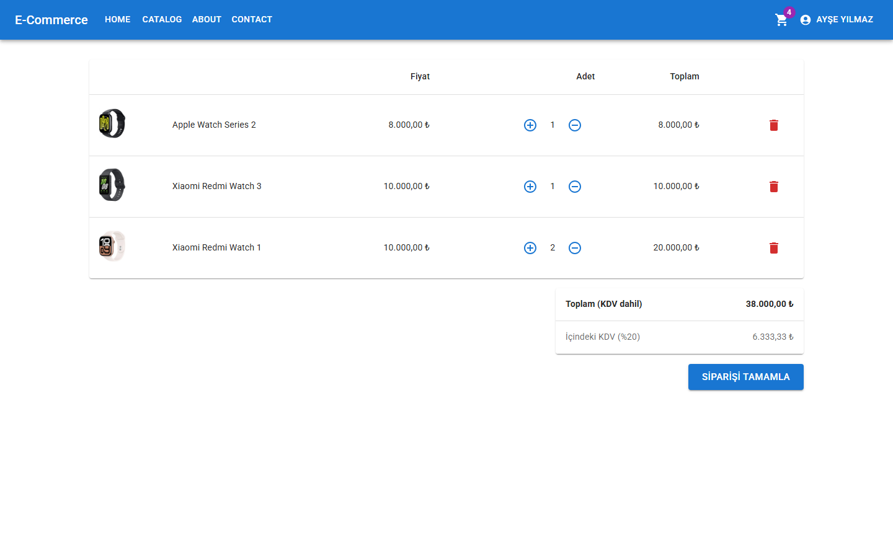
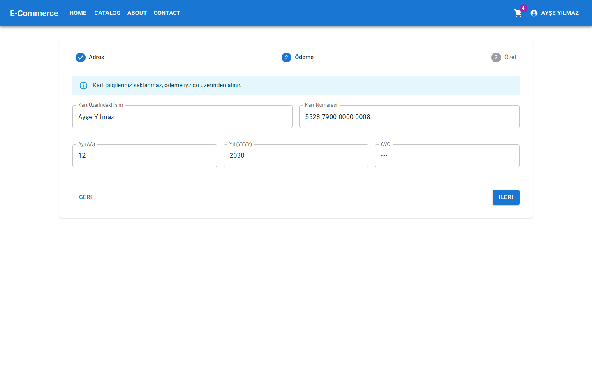
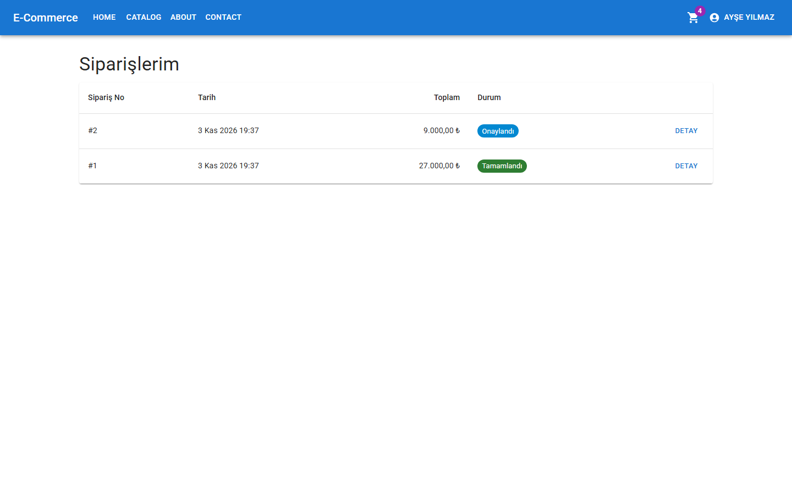
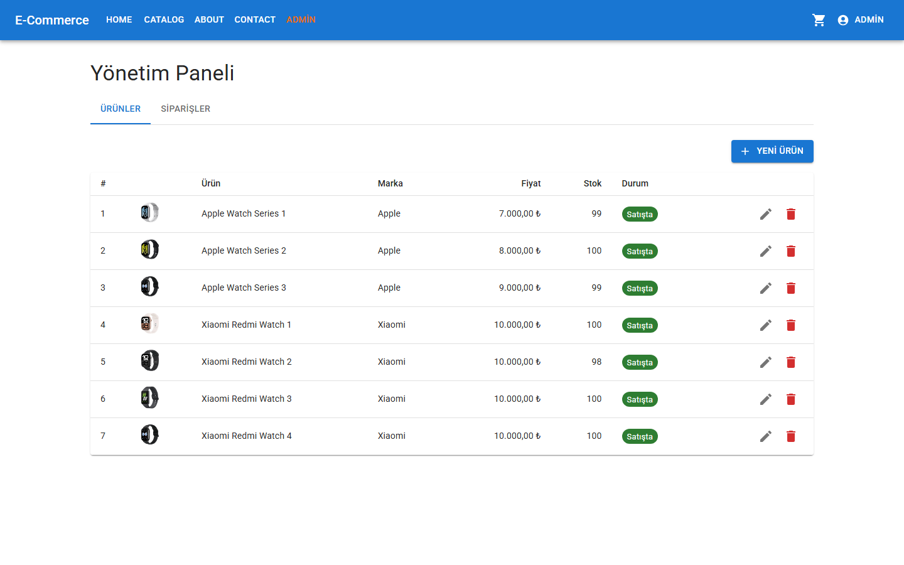
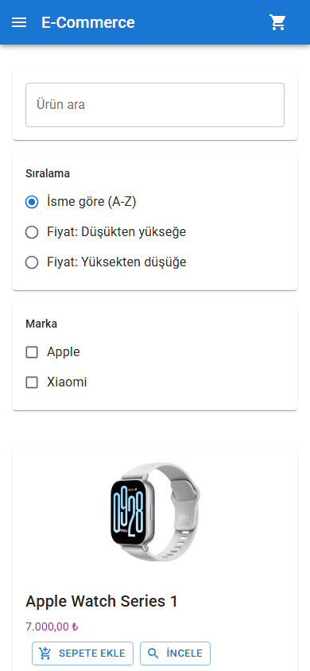
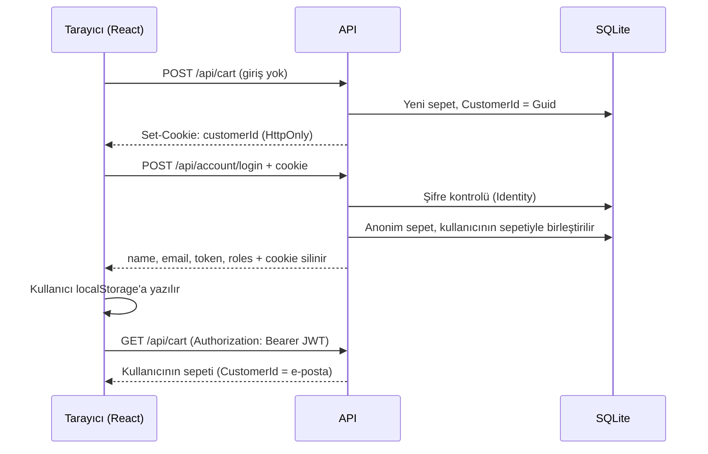

# E-Commerce · Akıllı Saat Mağazası

Anonim sepetten iyzico ödemesine ve admin paneline kadar uçtan uca çalışan, ASP.NET Core ve React ile yazılmış bir e-ticaret uygulaması.


## Ekran görüntüleri





| | |
|---|---|
|  <br> **Ürün detayı:** adet seçici, sepetteki adedi gösterir |  <br> **Sepet:** KDV dahil toplam ve içindeki KDV |
|  <br> **Checkout:** 3 adımlı form, ödeme adımı |  <br> **Siparişlerim:** sipariş durumu takibi |
|  <br> **Admin paneli:** ürün ve sipariş yönetimi |  <br> **Mobil:** hamburger menü, alt alta düzen |

## Özellikler

### Kullanıcı
- E-posta ile kayıt ve giriş (ASP.NET Core Identity + JWT)
- Sayfa yenilendiğinde oturum korunur; süresi dolan token'da otomatik çıkış ve giriş sayfasına yönlendirme
- Korumalı sayfalar (sipariş, checkout) girişten sonra kaldığı yere döner
- Mobil uyumlu arayüz, yüklenirken Skeleton ekranları, iletişim formu

### Sepet
- Giriş yapmadan sepete ekleme: anonim kullanıcı `HttpOnly` bir cookie ile takip edilir
- Giriş yapınca anonim sepet hesaptaki sepetle **birleşir** (stok sınırı aşılmadan)
- Stok ve "satışta mı" kontrolü sunucuda; fiyatlar KDV dahil, içindeki KDV ayrıca gösterilir

### Katalog, sipariş ve ödeme
- Arama (debounce), marka filtresi, fiyat/isim sıralaması, sunucu taraflı sayfalama
- Adres, ödeme ve özet adımlarından oluşan checkout; her adım ayrı doğrulanır
- Stok düşme, sipariş kaydı ve sepetin temizlenmesi **tek transaction**'da
- iyzico sandbox ile kartla ödeme; başarısız ödemede stok geri alınır, sepet korunur
- Kart bilgisi veritabanına yazılmaz ve loglanmaz; fiyatlar istemciden değil sunucudan alınır

### Admin
- Ürün ekleme, düzenleme ve satıştan kaldırma (soft delete)
- Görsel yükleme: tür ve boyut kontrolü, dosya içeriğine (magic bytes) göre doğrulama, Guid ile adlandırma
- Tüm siparişleri listeleme ve durum güncelleme (ödemesi başarısız sipariş kilitli)
- Yetki sunucuda kontrol edilir (`[Authorize(Roles = "Admin")]`); menüyü gizlemek sadece arayüz kolaylığıdır

## Teknolojiler ve mimari

| Katman | Kullanılanlar |
|---|---|
| Backend | ASP.NET Core .NET 10 Web API, EF Core 10 + SQLite, ASP.NET Core Identity, JWT Bearer, OpenAPI 3.0 + Swagger UI, Iyzipay |
| Frontend | React 19, TypeScript, Vite 8, React Router 8, MUI 9, axios, react-hook-form, react-toastify |

### Backend (`API/`)

| Klasör | Görevi |
|---|---|
| `Controllers/` | HTTP uç noktaları: Products, Cart, Account, Orders, Contact, Admin\* |
| `DTO/` | Dışarıya açılan veri şekilleri ve doğrulama kuralları. Entity'ler asla doğrudan dönülmez |
| `Entity/` | Veritabanı modelleri ve iş kuralları (ör. `Cart.AddItem`, `Order.CalculateDeliveryFee`) |
| `Services/` | `TokenService` (JWT), `PaymentService` (iyzico), `ImageService` (görsel yükleme) |
| `Extensions/`, `RequestHelpers/` | Arama/filtre/sıralama için `IQueryable` uzantıları, `PagedList<T>` |
| `Middlewares/` | Tüm hataları tek biçimde (`ProblemDetails`) döndüren `ExceptionHandling` |
| `Data/` | `DataContext` (IdentityDbContext), rol ve admin seed'i |

İstek hattı (middleware) sırası: `ExceptionHandling` → istek kültürü (invariant) → Swagger (sadece development) → HTTPS yönlendirme → statik dosyalar → CORS (sadece development) → `UseAuthentication` → `UseAuthorization` → controller'lar → React fallback.

### Frontend (`Client/src/`)

| Klasör | Görevi |
|---|---|
| `api/requests.ts` | axios; isteğe JWT ekleyen ve hataları (400/401/403/500, ağ hatası) tek yerden yöneten interceptor'lar |
| `context/` | Sepet ve hesap için global state (React Context) |
| `components/` | Header, `AuthGuard`, `AdminGuard`, Skeleton bileşenleri |
| `pages/` | Katalog, sepet, checkout, siparişler, hesap, admin sayfaları |
| `model/`, `utils/` | TypeScript tipleri, fiyat/tarih biçimleme, KDV ve kargo sabitleri |

### Kimlik doğrulama ve sepet birleştirme



## Kurulum

**Gereksinimler:** [.NET 10 SDK](https://dotnet.microsoft.com/download), [Node.js 22+](https://nodejs.org) ve EF Core CLI:

```bash
dotnet tool install --global dotnet-ef
```

**1. Veritabanı ve API** (http://localhost:5274, Swagger: http://localhost:5274/swagger)

```bash
cd API
dotnet ef database update   # SQLite dosyası repoda yok; migration ve seed verisiyle oluşturulur
dotnet run
```

İlk açılışta roller ve test admin hesabı oluşturulur.

**2. Client** (http://localhost:3000), ayrı bir terminalde:

```bash
cd Client
npm install
npm run dev
```

**3. Gizli ayarlar (user-secrets).** Repoda gizli bilgi tutulmaz. Development'ta JWT için test anahtarı hazır gelir; kendi değerlerinizi şöyle verebilirsiniz:

```bash
cd API
dotnet user-secrets set "JWTSecurityKey" "<en az 32 karakterlik rastgele bir değer>"
dotnet user-secrets set "Iyzico:ApiKey" "<iyzico sandbox api key>"
dotnet user-secrets set "Iyzico:SecretKey" "<iyzico sandbox secret key>"
```

> iyzico anahtarları tanımlı değilse uygulama çökmez; ödeme **başarılı kabul edilir** (simülasyon) ve loga uyarı yazılır.

### Production (tek uygulama)

React build'i API'nin `wwwroot/app` klasörüne yazılır ve API'nin kendisinden sunulur. Production'da CORS ve Swagger kapalıdır, user-secrets yüklenmez:

```bash
cd Client && npm run build && cd ../API
JWTSecurityKey="<en az 32 karakter>" dotnet run --no-launch-profile -- --environment Production --urls http://localhost:5274
```

PowerShell'de anahtarı önce `$env:JWTSecurityKey = "..."` ile verin. Anahtar yoksa uygulama bilerek başlamaz.

## Test hesapları ve kartı

| | Bilgi |
|---|---|
| Admin (sadece development) | `admin@eticaret.test` / `Admin123!` |
| Müşteri | Kayıt sayfasından oluşturabilirsiniz |
| iyzico test kartı | `5528 7900 0000 0008`, son kullanma `12/2030`, CVC `123` |

Başarısız ödemeyi denemek için gerçek sandbox anahtarlarıyla `4111 1111 1111 1129` (yetersiz bakiye) kartını kullanabilirsiniz. Güncel test kartları için [iyzico dokümantasyonuna](https://docs.iyzico.com) bakın.

## Proje hikâyesi

Bu proje bir Udemy kursuyla başladı. Ürün API'si, katalog, hata yönetimi ve cookie tabanlı sepet gibi temel kısımları, Bölüm 8'e (sepet) kadar kursu takip ederek kendim yazdım.

Bölüm 8'in kalanını ve sonrasını [Claude Code](https://claude.com/claude-code) ile tamamladım: temizlik ve DTO'lar, katalog filtreleri, Identity + JWT, sipariş ve checkout, iyzico ödemesi, admin paneli ve son rötuşlar. Her adımı ayrı bir prompt olarak tarif ettim, değişikliklerin nedenini açıklamasını istedim ve her adımı build, lint, API ve tarayıcı testleriyle doğrulattım. Koddaki `//?` (açıklama) ve `//!` (önemli uyarı) yorumları bu sürecin parçası; amaç sadece çalışan bir proje değil, neden böyle yazıldığını anlamaktı.

## Geliştirilebilecekler

- **Rate limiting:** Herkese açık uçlara (giriş, kayıt, iletişim formu) IP başına istek sınırı
- **Code splitting:** Admin ve checkout sayfalarını `lazy()` ile ayrı paketlere bölmek (ana JS paketi ~810 kB)
- **Gerçek iyzico entegrasyonu:** 3D Secure, kullanıcıdan T.C. kimlik no alma, iade ve iptal; ödeme sırasında veritabanı kilidini kısaltmak
- **Testler:** Backend için xUnit entegrasyon testleri, frontend için Playwright testlerinin CI'da çalışması
